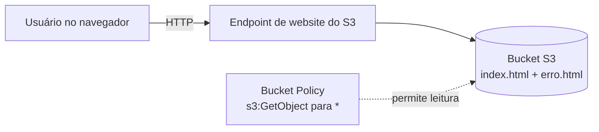

# Lab 01 — Site estático hospedado no Amazon S3

**Site no ar:** http://joaolucasxs-portfolio.s3-website-sa-east-1.amazonaws.com

## Objetivo
Hospedar uma página HTML pública usando apenas o S3, sem servidor, entendendo bucket, hospedagem estática e política de acesso.

## Arquitetura



## Passos executados
1. Criado o bucket `joaolucasxs-portfolio` na região sa-east-1 (São Paulo), namespace global, com Block Public Access desativado
2. Upload de `index.html` e `erro.html`
3. Ativada a hospedagem estática em Properties, com index e error document
4. Aplicada bucket policy permitindo apenas `s3:GetObject` para qualquer principal

## Política aplicada
```json
{
  "Version": "2012-10-17",
  "Statement": [
    {
      "Sid": "LeituraPublica",
      "Effect": "Allow",
      "Principal": "*",
      "Action": "s3:GetObject",
      "Resource": "arn:aws:s3:::joaolucasxs-portfolio/*"
    }
  ]
}
```
`Principal: "*"` = qualquer pessoa · `s3:GetObject` = só leitura de objetos, sem listar ou alterar · `/*` = todos os arquivos do bucket.

## Prints


## O que aprendi
- Um bucket é privado por padrão; publicar exige desativar o Block Public Access **e** uma policy explícita — as duas coisas, não uma
- A policy concede só leitura; ninguém consegue listar ou alterar o bucket
- O endpoint de website é HTTP; para HTTPS e cache seria necessário CloudFront (próximo lab)
- Nome de bucket é globalmente único, mas o bucket vive em uma região

## Custo
Zero. S3 no Free Tier: 5 GB de armazenamento e 20 mil GETs/mês. Este lab usa menos de 1 KB.
